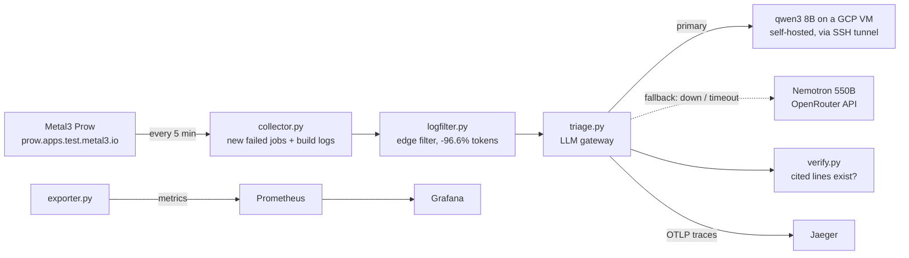

# Observable LLM Triage for CI Failures

When a CI job of the [Metal3](https://metal3.io) project fails, this service fetches the build log, cuts it down to the lines that matter, asks an LLM why the job failed, and checks the line numbers the model cites. Every step is traced with OpenTelemetry and shown in Grafana and Jaeger, so you can see what the model did and judge whether to trust its answer.

Course project for CS-E4660 Advanced Topics in Software Systems, Aalto University, 2026.

**Research question:** can an LLM-in-the-loop CI triage service be made observable and checkable end to end, and how do self-hosted and cloud models compare in latency, cost and quality?

## Architecture



| Step | File | What it does |
|---|---|---|
| Collect | `collector.py` | Reads Prow's `data.js`, saves the build log of each new failed job to `data/failures/<job>-<build>/`, and keeps an hourly snapshot of all jobs for the CI-health dashboard. |
| Filter | `logfilter.py` | Keeps error lines with 3 lines of context, the last 10 lines, and the original line numbers. Drops info-level logs and coverage output. |
| Triage | `triage.py` | Sends the filtered log to the model and gets back JSON `{category, summary, cited_lines}`. The category is one of `flaky_test`, `infra_timeout`, `code_bug`, `config_error`, `unknown`. |
| Fallback | `triage.py serve` | Self-hosted model first. If it is unreachable or slower than 300 s, the cloud API answers. A circuit breaker skips a dead server for 30 s, and a 2 s connect check catches dead links fast. |
| Watch | `triage.py watch` | Runs collect, filter and triage every 5 minutes, only for failures it has not seen. Reports its own liveness. |
| Verify | `verify.py` | Checks every cited line number against the log the model was shown. Made-up lines lower the citation validity. |
| Labels | `labels.py` | Hand labels (`data/labels.csv`) and per-model accuracy. |
| Metrics | `exporter.py` | Prometheus metrics for CI health, model latency, accuracy, citation validity, tokens, fallbacks, filter savings and watcher liveness. |
| Failure injection | `failover_test.py` | Cuts the link to the self-hosted model mid-run and measures how long until the fallback answers. |

Each triaged failure is one trace in Jaeger: a root span with the Prow job details, then `filter`, one `llm` span per attempt (a failed attempt is marked as an error), then `verify`. LLM spans carry the OpenTelemetry GenAI attributes (`gen_ai.request.model`, `gen_ai.usage.input_tokens`, `gen_ai.usage.output_tokens`) plus latency, time to first token and tokens per second.

## Results

Data: 43 failed Metal3 jobs collected from Prow on 27–31 October 2026, labelled by hand. 21 of them are merge conflicts, which the category list does not cover well, so accuracy is reported on the 22 failures with a clear answer.

### Model comparison

| Model | Runs on | Correct on the 8-failure test set | Correct on the 22 clear-cut failures | Cited lines that exist | Median latency |
|---|---|---|---|---|---|
| **qwen3 8B, thinking on** | GCP VM, CPU | **7/8** | n/a | 30/30 | 126 s |
| Nemotron 3 Ultra 550B | OpenRouter | 6/8 | **20/22** | 173/173 | 7 s |
| gemma3 12B | GCP VM, CPU | 5/8 | n/a | 26/26 | 52 s |
| qwen3 8B, thinking off | GCP VM, CPU | 4/8 | 10/20 | 143/143 | 21 s |
| llama3 8B | laptop, CPU | 4/8 | 8/22 | 187/187 | 30 s |
| llama3.2 3B | laptop, CPU | 3/8 | 13/22 | 113/127 (89%) | 11 s |

What stands out:

- **Reasoning mattered more than size.** qwen3 8B went from 4/8 to 7/8 with thinking on, ahead of the bigger gemma3 12B. The cost is time: about 800 output tokens, mostly reasoning, at about 7 tokens/s on CPU.
- **llama3 8B was biased.** It labels almost every failure `code_bug`, which is why it scored below the 3B model.
- **Only the 3B model invented evidence.** 11% of its cited lines were not in the log it was shown.
- **The 8-failure test set has one example of each kind of clear-cut failure.** It was also used to pick the model, so qwen3's 7/8 is optimistic. Failures collected later are the fair test.

### Edge filter

The 43 build logs total about 630,800 tokens. After filtering, the models read about 21,700, **96.6% less**. The largest single log is about 430,000 tokens, more than these models accept, so without the filter some failures could not be triaged at all.

Monitoring the share of each log kept showed a limit: on long Go unit-test logs, passing tests print lines like "adding error message" that a regex cannot tell apart from a real failure.

### Failover

The link to the self-hosted model was killed while it was answering:

| Setup | Primary | Fallback | Recovery (kill to first fallback answer) | Fallback median latency | Citation validity after |
|---|---|---|---|---|---|
| Real: two machines | qwen3 8B on GCP | Nemotron 550B, OpenRouter | **6.7 s** | 9.2 s | 100% |
| Emulated: one laptop | llama3 8B | llama3.2 3B | 26.6 s | 17.9 s | 88% |

In the real setup the fallback was faster and at least as accurate as the primary. What the self-hosted model buys is that CI logs stay on your own infrastructure. The API is only used while the server is down.

## Running it

Requirements: Docker with Compose v2, Python 3.12, an [OpenRouter](https://openrouter.ai) API key, and a machine running [Ollama](https://ollama.com) with `qwen3:8b` (a VM with 8 vCPUs and 32 GB RAM works).

```bash
python3 -m venv .venv && .venv/bin/pip install -r requirements.txt
export OPENROUTER_API_KEY=...                         # keep it out of the repo

# link to the model server: the llm-server container forwards :11435 to this tunnel
ssh -N -L 11436:localhost:11434 <user>@<vm-ip> &
# (to use a local Ollama instead: LLM_SERVER_TARGET=localhost:11434 docker compose up -d)

docker compose up -d                                  # exporter, Prometheus, Grafana, Jaeger, llm-server link
.venv/bin/python triage.py watch                      # poll Prow every 5 min and triage new failures
```

- Grafana: http://localhost:3000 (admin / admin). Dashboards *Metal3 CI health* and *Metal3 LLM triage*.
- Jaeger: http://localhost:16686, service `metal3-triage`.

Other commands:

```bash
python3 collector.py && python3 logfilter.py          # one collection by hand
.venv/bin/python triage.py serve                      # triage all saved failures once, with fallback
.venv/bin/python triage.py openrouter                 # batch-run one model on every failure
OLLAMA_URL=http://localhost:11436 OLLAMA_MODEL=qwen3:8b OLLAMA_THINK=1 .venv/bin/python triage.py ollama
.venv/bin/python failover_test.py                     # failure injection
python3 labels.py                                     # label failures by hand; `labels.py score` for accuracy
```

Tests (no models or network needed):

```bash
for t in test_logfilter test_verify test_labels test_exporter; do python3 $t.py; done
.venv/bin/python test_triage.py
```

## Limitations

- **Small data.** 43 failures from four days, with 21 merge conflicts. The model test set has only 8 failures, run once.
- **Labels were drafted by Claude and reviewed by the author.** They are not blind: the drafter had seen the models' answers.
- **CPU only.** All self-hosted latencies are CPU numbers. A GPU would make qwen3 with thinking roughly ten times faster.
- **Polling, not events.** Prow can push job events, but only to whoever runs the cluster. An outsider can only poll the public `data.js`.
- **The watcher runs on a laptop.** It stops when the laptop sleeps, and the SSH tunnel drops with it.
- **The free OpenRouter model** can be rate-limited or withdrawn at any time.

## Repository layout

```
collector.py  logfilter.py  triage.py  verify.py  labels.py  exporter.py  failover_test.py
test_*.py                       one test file per component
docker-compose.yml  prometheus.yml  grafana/   monitoring stack and dashboards
data/failures/<job>-<build>/    build-log.txt, filtered.txt, meta.json, triage-<model>.json
data/labels.csv                 hand labels
data/failover-*.jsonl           failover test logs
```
